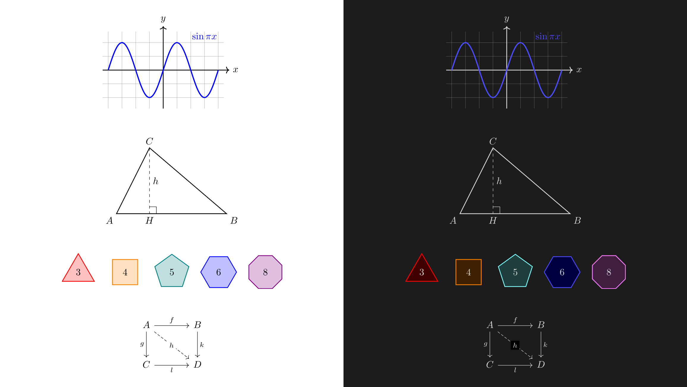
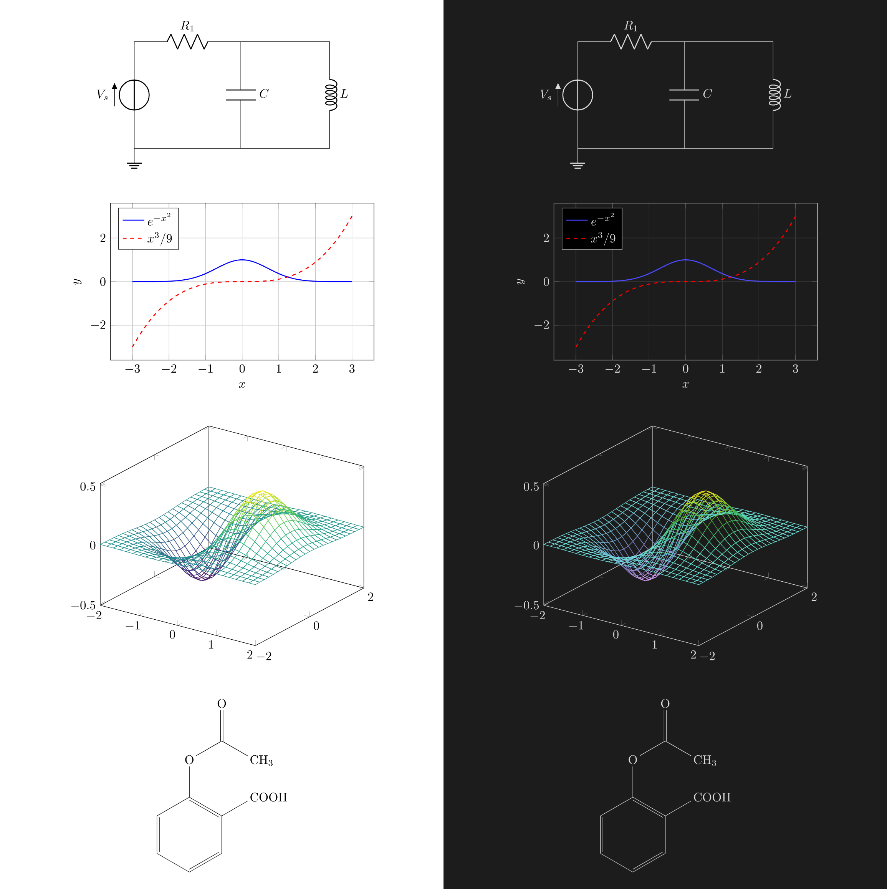
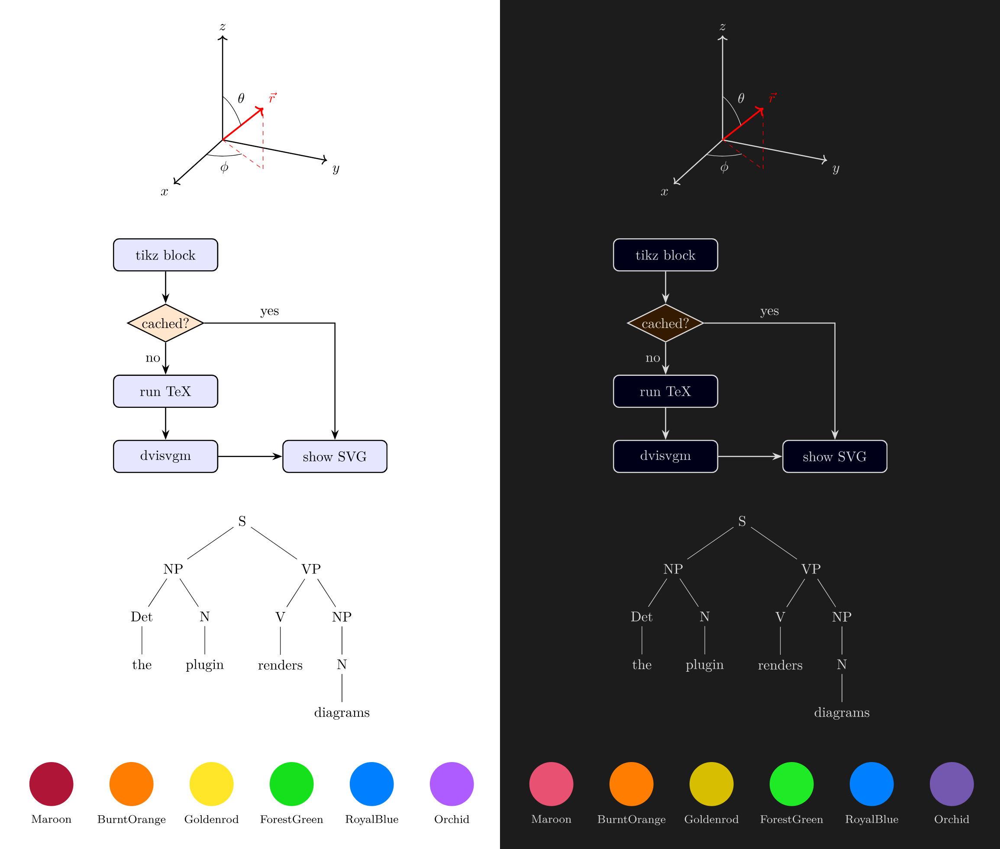
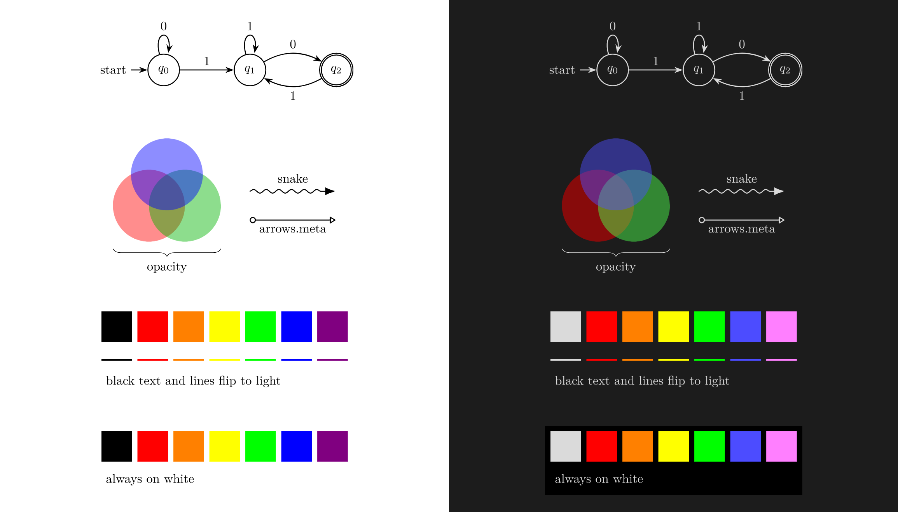

# Native TikZ

[](https://github.com/dingzy53/obsidian-tikz/releases/latest)
[](https://community.obsidian.md/plugins/tikz)
[](https://obsidian.md)
[](LICENSE)

Render ` ```tikz ` code blocks in [Obsidian](https://obsidian.md) with your **locally installed TeX distribution** (TeX Live, MacTeX or MiKTeX) instead of a browser WASM engine. A rewrite of [`artisticat1/obsidian-tikzjax`](https://github.com/artisticat1/obsidian-tikzjax), see [License](#license).



## Features

- Full TikZ and any LaTeX package, compiled by your own TeX installation.
- The real compiler log when a diagram fails, and a timeout instead of an endless spinner.
- Colours adapted for dark themes.
- A render cache inside the plugin folder. Nothing is written into your notes' folders.

## Requirements

- **Obsidian Desktop** (Windows, macOS, Linux). Mobile is unsupported (no Node.js child processes).
- A TeX distribution with **`dvisvgm`** installed:
  - **Windows**: [MiKTeX](https://miktex.org/download) or [TeX Live](https://www.tug.org/texlive/windows.html)
  - **macOS**: [MacTeX](https://www.tug.org/mactex/) (or via Homebrew: `brew install --cask mactex-no-gui`)
  - **Linux**: [TeX Live](https://www.tug.org/texlive/)
    - Ubuntu/Debian: `sudo apt install texlive-latex-extra texlive-luatex texlive-pictures dvisvgm`
    - Fedora: `sudo dnf install texlive-scheme-medium dvisvgm`
    - Arch Linux: `sudo pacman -S texlive-basic texlive-latexextra texlive-pictures dvisvgm`
  - *Linux Flatpak note*: If running Obsidian via Flatpak (`md.obsidian.Obsidian`), the plugin automatically executes host TeX binaries via `flatpak-spawn --host` and uses `~/.cache/obsidian-tikz` for scratch files without extra setup.

## Installation

**From the community directory** (recommended)

1. Open **Settings → Community plugins** and turn on community plugins if asked.
2. Select **Browse**, search for **TikZ**, then select **Install** and **Enable**.

You can also open the plugin's page: [community.obsidian.md/plugins/tikz](https://community.obsidian.md/plugins/tikz).

**Manually**

1. Download `main.js`, `manifest.json` and `styles.css` from the [latest release](https://github.com/dingzy53/obsidian-tikz/releases/latest).
2. In **Settings → Community plugins**, select the folder icon next to **Installed plugins**. This opens `<vault>/.obsidian/plugins/`.
3. Create a folder named `tikz` there and put the three files in it.
4. Select the reload icon next to **Installed plugins**, then enable **TikZ**.

**Beta versions:** install [BRAT](https://github.com/TfTHacker/obsidian42-brat) and add `dingzy53/obsidian-tikz`.

**Update or remove:** select **Check for updates** or **Uninstall** in **Settings → Community plugins**.

## Usage

Place TikZ code inside a ` ```tikz ` block. Standard figures, bare snippets, or complete documents are all supported:

````markdown
```tikz
\begin{document}
\begin{tikzpicture}
  \draw[thick, ->] (0,0) -- (1,1) node[right] {$x$};
\end{tikzpicture}
\end{document}
```
````

Bare TikZ snippets and packages loaded inline are also accepted:

````markdown
```tikz
\usepackage{forest}
\begin{forest}
[VP [NP [Det][N]] [V]]
\end{forest}
```
````

### Cache & Scratch Files

- **Render cache**: Compiled diagrams (`<hash>.svg`) are saved in `<vault>/.obsidian/plugins/tikz/cache/` (hidden inside the plugin directory; zero vault pollution). Failed compiles are not cached; the error block shows the live compiler log. When the entry limit is reached, the least recently *used* diagrams are dropped first.
- **Compile scratch files**: Temporary TeX build files (`.tex`, `.dvi`, `.log`) live in your OS temp folder (`os.tmpdir()/obsidian-tikz/`, or `~/.cache/obsidian-tikz/` on Flatpak) and are cleaned up immediately upon completion.

## Showcase

Diagrams rendered side-by-side in **Light mode** (left) and **Dark mode** (right) with automatic adaptive contrast:

### Circuits & Scientific Plots


### 3D Coordinates & Diagrams


### Automata & Theme Adaptation


## Settings

| Setting | Description | Default |
|---|---|---|
| **Dark mode colours** | `Adaptive` (mirrors lightness with contrast floor), `Light canvas` (light panel), or `Off`. | `Adaptive` |
| **TeX engine** | `dvilualatex` (recommended), `latex`, `xelatex`, or `pdflatex`. | `dvilualatex` |
| **Binary paths** | Custom path overrides for TeX engine and `dvisvgm`, with an **Auto-detect** button. | Auto (`PATH`) |
| **Extra PATH** | Extra directories to append to `PATH` at runtime. | Empty |
| **Default preamble** | Common packages injected when no `\documentclass` is provided. | Standard TikZ packages |
| **Allow shell escape** | Enables `-shell-escape` (danger: executes arbitrary system commands). | `false` |
| **Compile timeout** | Maximum seconds per compilation stage (1–3600) before killing the process tree. Time spent queued does not count. | `20` |
| **Parallel compiles** | How many diagrams compile at once; the rest queue. `0` = automatic (half the CPU cores, 1–4). | `0` |
| **Maximum cache** | Maximum cached SVGs (0 = unlimited). | `500` |

> [!NOTE]
> On macOS, GUI apps launched from Finder or the Dock do not inherit your shell's `PATH`. If binaries show as "not found", click **Detect automatically** or set the path manually (e.g. `/Library/TeX/texbin`).

## Dark mode

- **Adaptive** (default): Automatically mirrors colour lightness while maintaining a 3:1 contrast floor, ensuring labels and shapes remain legible against dark themes.
- **Light canvas**: Keeps original colours untouched and shows the diagram on a light panel (ideal for complex shading, `ball color`, or colormaps).
- **Off**: Leaves colours unchanged.

To force a diagram to look identical in both light and dark themes, give it a background rectangle:
```tikz
\usetikzlibrary{backgrounds}
\begin{tikzpicture}[
    show background rectangle,
    background rectangle/.style={fill=white, draw=none},
  ]
  \draw[thick, ->] (0,0) -- (1,1) node[right] {$x$};
\end{tikzpicture}
```

## Privacy and security

- **Running programs:** the plugin starts only your TeX engine and `dvisvgm`, with an argument list and never through a shell. Under Flatpak it runs them on the host with `flatpak-spawn --host`.
- **Files outside the vault:** compile scratch files go to the system temp folder (`~/.cache/obsidian-tikz/` under Flatpak) and are deleted after each compile. The render cache stays in the plugin folder.
- **Network:** none. If MiKTeX is set to install missing packages, MiKTeX itself may download them.
- **Clipboard:** written only by the **Copy log** button on a failed diagram.

**Security**

- **Shell escape is off by default**: Vault content is untrusted; `-shell-escape` is never enabled unless explicitly turned on by the user.
- **Direct argv execution**: Subprocesses are spawned with an argv array (`spawn`/`execFile`), never interpolated shell strings.
- **File reads are not sandboxed**: Like any TeX run, a diagram can `\input` or `\includegraphics` any file your user account can read, and render it into the note and the plugin cache. TeX Live dropped `openin_any` read restrictions in 2026 as ineffective, so only open vaults you trust. Shell escape stays off either way.
- **SVG sanitization (allowlist, fail-closed)**: The SVG is parsed and only the elements dvisvgm/PGF emit are kept; event handlers, external `href`/`url()` references, `<style>`, `<a>` and animation elements are removed. An SVG that cannot be parsed is rejected rather than displayed, and the result is inserted via `DOMParser`, never `innerHTML`.

## Development

```bash
npm run dev     # watch build (outputs main.js)
npm run build   # typecheck + production bundle
npm run lint    # eslint
npm test        # vitest unit tests
npm run clean   # clean generated bundle files
```

See [AGENTS.md](AGENTS.md) for architectural constraints and contribution rules.

## License

[MIT](LICENSE) © 2026 Ding Zheng Yuan.

This plugin started as a fork of [`artisticat1/obsidian-tikzjax`](https://github.com/artisticat1/obsidian-tikzjax) (MIT, © 2021–2023 artisticat1). The settings scaffolding and the ` ```tikz ` code block tag come from it; the rendering engine was rewritten to use a local TeX installation. Both copyright notices are kept in [LICENSE](LICENSE).
